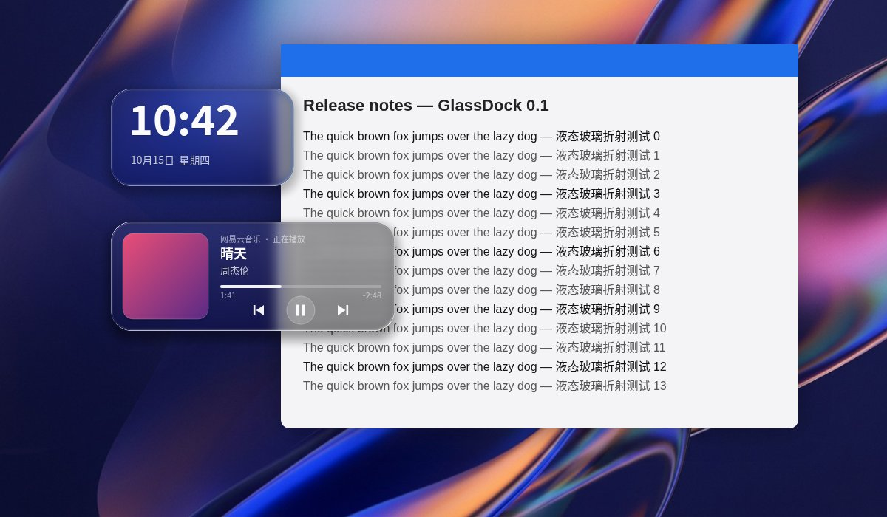

# GlassDock

Windows 液态玻璃桌面小组件。实时抓取桌面画面，用 GPU 着色器做折射、色散、磨砂和锐利描边，不是贴图模拟。



> 预览图由同一套着色器的 WebGL 镜像（`preview/preview.html`）渲染。

## 功能（v0.1）
- **时钟**
- **音乐卡片**：接入系统媒体控制（SMTC），显示封面、歌名、歌手和进度，可以上一首、播放/暂停、下一首。支持网易云音乐、Spotify、QQ音乐、浏览器等。
- 实时折射身后的窗口和壁纸，组件自身不会出现在抓屏里，不会产生反馈循环
- 左键拖动，位置自动记忆；右键菜单可以切换置顶、编辑配置、退出
- `glassdock.toml` 热重载，所有材质参数保存后立即生效

## 运行
要求 Windows 10 2004+ 或 Windows 11。双击 `glassdock.exe` 即可，免安装。

网易云音乐需要在客户端打开：设置 → 系统 → 开启SMTC。客户端自带的 SMTC 不提供进度条，要显示进度可以装 InfLink-rs 插件。

## 构建
Windows（MSVC）：先删除 `.cargo/` 文件夹（它是 Linux 交叉编译用的），然后
```
cargo build --release
```
Linux 交叉编译：
```
sudo apt install gcc-mingw-w64-x86-64
rustup target add x86_64-pc-windows-gnu
cargo build --release
```

## 结构
| 文件 | 作用 |
|---|---|
| `src/main.rs` | 主循环、配置热重载、菜单动作 |
| `src/gfx.rs` | D3D11 设备、DXGI Desktop Duplication 抓屏、着色器编译、D2D/DirectWrite |
| `src/glass.hlsl` | 玻璃着色器 |
| `src/widget.rs` | 每个组件对应一个 DirectComposition 窗口，负责绘制、拖动和按钮 |
| `src/media.rs` | SMTC 曲目、封面、播放控制 |
| `src/config.rs` | 配置结构与默认材质 |
| `preview/preview.html` | 浏览器预览 / 调参（例如 `?blur=4&rim=0.8`） |

## 已知限制
- 只抓主显示器
- DPI 变化后不会重新排版
- 暂无托盘图标，组件之间也还不会融合
